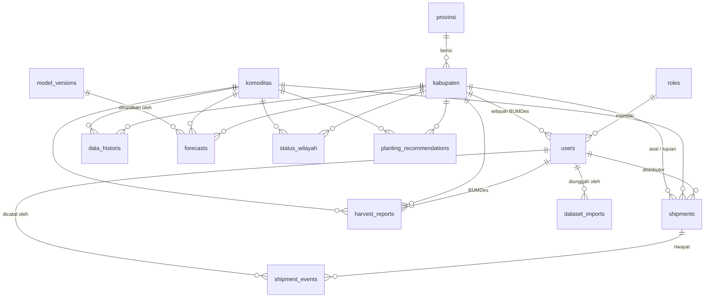

# Skema Database: Sistem Pemantauan & Early-Warning Surplus Pangan

| Item | Detail |
|---|---|
| **Dokumen** | databaseschema.md (pendamping `prd.md` v1.1 dan `infrastruktur.md`) |
| **Versi** | v1.0 – Draft |
| **Tanggal** | 11 Oktober 2026 |
| **DBMS** | MySQL (InnoDB, `utf8mb4`) **[Keputusan]** |
| **Framework** | Laravel (migrasi, Eloquent) **[Keputusan]** |

> **Legenda:** **[Keputusan]** = dari PRD/tim · **[Asumsi]** = kesimpulan saya, perlu dikonfirmasi · **[Rekomendasi]** = saran implementasi.

---

## 1. Prinsip Desain

1. **Satuan besaran: kg**, disimpan apa adanya. Konversi ke ton hanya saat **tampilan** (≤ 2.000 kg → kg, > 2.000 kg → ton 1 desimal) **[Keputusan]**.
2. **`periode` disimpan sebagai `DATE` tanggal 1** setiap bulan (mis. `2023-01-01`), bukan teks `YYYY-MM`, agar mudah diurutkan dan dihitung selisihnya. Impor CSV mengubah `2023-01` → `2023-01-01` **[Rekomendasi]**.
3. **Sel kosong = data tidak diketahui (`NULL`)**, sedangkan **`0` = benar-benar nol** **[Keputusan dari aturan dataset]**.
4. **Kode wilayah** (`provinsi.kode`, `kabupaten.kode`) harus sama dengan kode pada GeoJSON dan dataset CSV. Disimpan sebagai **teks** agar angka nol di depan tidak hilang.
5. **Prediksi tidak menimpa riwayat**: setiap pengiriman `forecasts.csv` bulanan ditambahkan, sehingga aktual vs prediksi bisa dievaluasi.
6. **Tabel `status_wilayah`** menyimpan hasil hitungan siap pakai untuk peta (peningkatan performa) **[Rekomendasi]**.
7. Nama tabel master (`provinsi`, `kabupaten`, `komoditas`) memakai bentuk Indonesia tunggal. Pada model Eloquent set `protected $table = 'kabupaten';` dst., karena Laravel otomatis menjamakkan nama bahasa Inggris.

## 2. Diagram Relasi (ER)



## 3. Daftar Tabel

| # | Tabel | Fungsi | Sumber PRD |
|---|---|---|---|
| 1 | `roles` | Peran pengguna | 4 (Pengguna & Peran) |
| 2 | `users` | Akun (distributor, BUMDes, admin) | 4 |
| 3 | `provinsi` | Master provinsi | 9.3 |
| 4 | `kabupaten` | Master kabupaten/kota | 9.3 |
| 5 | `komoditas` | Master komoditas (beras, jagung, singkong) | 9.3 |
| 6 | `data_historis` | Dataset riil 2023–2025 dan data bulan baru | 9.2 |
| 7 | `forecasts` | Hasil prediksi 12 bulan (riwayat tiap pengiriman) | 9.2b |
| 8 | `status_wilayah` | Status siap pakai per kabupaten, komoditas, bulan | 8, 6.1 **(tambahan)** |
| 9 | `shipments` | Pengiriman distributor (resi diinput sendiri) | F-07, F-08 |
| 10 | `shipment_events` | Riwayat perjalanan/status pengiriman (manual) | F-08 |
| 11 | `harvest_reports` | Laporan BUMDes: panen dan sisa stok (survei) | F-09 |
| 12 | `planting_recommendations` | Rekomendasi jadwal tanam (**dummy**) | F-10 |
| 13 | `settings` | Ambang status, teks disclaimer, pesan dampak | 8.3, 8.4 |
| 14 | `model_versions` | Versi model ML dan metriknya | 10 |
| 15 | `dataset_imports` | Log impor CSV | 11 **(tambahan)** |
| 16 | `audit_logs` *(opsional)* | Jejak perubahan penting | 13 **(Could)** |

Tabel bawaan Laravel (`password_reset_tokens`, `sessions`, `cache`, `cache_locks`, `jobs`, `failed_jobs`) tetap dipakai sesuai konfigurasi.

> **Perbedaan dari PRD 9.3:** tabel `planting_calendar` **tidak dibuat** karena jadwal tanam dibuat dummy **[Keputusan]**. Tabel `status_wilayah`, `dataset_imports`, dan `audit_logs` ditambahkan sebagai kebutuhan implementasi **[Rekomendasi]**.

---

## 4. Definisi Tabel

Notasi: **PK** primary key · **FK** foreign key · **UQ** unique · **NN** not null · tipe angka kg memakai `DECIMAL(16,2)` agar muat nilai besar tanpa pembulatan **[Asumsi]**.

### 4.1 `roles`
| Kolom | Tipe | Aturan | Keterangan |
|---|---|---|---|
| id | BIGINT UNSIGNED | PK | |
| kode | VARCHAR(20) | NN, UQ | `distributor`, `bumdes`, `admin` |
| nama | VARCHAR(50) | NN | Label tampilan |
| created_at, updated_at | TIMESTAMP | NULL | |

### 4.2 `users`
| Kolom | Tipe | Aturan | Keterangan |
|---|---|---|---|
| id | BIGINT UNSIGNED | PK | |
| role_id | BIGINT UNSIGNED | NN, FK → roles.id | |
| kabupaten_id | BIGINT UNSIGNED | NULL, FK → kabupaten.id | **Wajib terisi untuk BUMDes** (satu akun = satu kabupaten) **[Keputusan]**; divalidasi di aplikasi |
| name | VARCHAR(150) | NN | |
| email | VARCHAR(190) | NN, UQ | Dipakai untuk login |
| email_verified_at | TIMESTAMP | NULL | |
| password | VARCHAR(255) | NN | Hash |
| organisasi | VARCHAR(150) | NULL | Nama perusahaan distributor / nama BUMDes |
| telepon | VARCHAR(25) | NULL | |
| is_active | BOOLEAN | NN, default 1 | |
| remember_token | VARCHAR(100) | NULL | |
| created_at, updated_at | TIMESTAMP | NULL | |

Catatan: akun **dibuat oleh Admin** (tidak ada registrasi mandiri) **[Asumsi dari PRD]**. Pengunjung publik tidak punya akun.

### 4.3 `provinsi`
| Kolom | Tipe | Aturan | Keterangan |
|---|---|---|---|
| id | BIGINT UNSIGNED | PK | |
| kode | CHAR(2) | NN, UQ | Kode 2 digit, mis. `33`; sama dengan GeoJSON |
| nama | VARCHAR(100) | NN | |
| created_at, updated_at | TIMESTAMP | NULL | |

### 4.4 `kabupaten`
| Kolom | Tipe | Aturan | Keterangan |
|---|---|---|---|
| id | BIGINT UNSIGNED | PK | |
| provinsi_id | BIGINT UNSIGNED | NN, FK → provinsi.id | |
| kode | CHAR(4) | NN, UQ | Kode 4 digit, mis. `3302`; **sama dengan GeoJSON dan dataset** |
| nama | VARCHAR(100) | NN | |
| tipe | ENUM('kabupaten','kota') | NN, default 'kabupaten' | |
| jumlah_penduduk | BIGINT UNSIGNED | NULL | Terbaru; opsional |
| lat, lng | DECIMAL(9,6) | NULL | Titik tengah (opsional, untuk pencarian/zoom) |
| created_at, updated_at | TIMESTAMP | NULL | |

Indeks: UQ `kode`; index `provinsi_id`.

### 4.5 `komoditas`
| Kolom | Tipe | Aturan | Keterangan |
|---|---|---|---|
| id | BIGINT UNSIGNED | PK | |
| kode | VARCHAR(20) | NN, UQ | `beras`, `jagung`, `singkong` (huruf kecil, sama dengan CSV) |
| nama | VARCHAR(50) | NN | Label tampilan |
| created_at, updated_at | TIMESTAMP | NULL | |

### 4.6 `data_historis`
Satu baris = **satu kabupaten × satu komoditas × satu bulan**. Memuat dataset 2023–2025 dan data bulan baru. Cocok dengan kolom `dataset_template.csv`.

| Kolom | Tipe | Aturan | Keterangan |
|---|---|---|---|
| id | BIGINT UNSIGNED | PK | |
| kabupaten_id | BIGINT UNSIGNED | NN, FK → kabupaten.id | |
| komoditas_id | BIGINT UNSIGNED | NN, FK → komoditas.id | |
| periode | DATE | NN | Tanggal 1 tiap bulan |
| panen_kg | DECIMAL(16,2) | NULL | Hasil panen (target model) |
| stok_awal_kg | DECIMAL(16,2) | NULL | Sisa bulan sebelumnya; data historis tersedia tiap bulan **[Keputusan]**; sel kosong dihitung cadangan |
| pasokan_masuk_kg | DECIMAL(16,2) | NULL | Dari luar kabupaten/kota; **diisi 0 bila tidak ada** **[Keputusan]** |
| supply_kg | DECIMAL(16,2) | NULL | `panen + stok_awal + pasokan_masuk`; boleh kosong lalu dihitung |
| demand_kg | DECIMAL(16,2) | NULL | Kebutuhan berbasis penjualan (atau proxy) |
| curah_hujan_mm | DECIMAL(7,2) | NULL | |
| jumlah_penduduk | BIGINT UNSIGNED | NULL | Opsional |
| luas_panen_ha | DECIMAL(12,2) | NULL | Opsional |
| flag_estimasi | BOOLEAN | NN, default 0 | `1` = nilai hasil estimasi/pemecahan statistik |
| sumber_data | VARCHAR(150) | NULL | Untuk audit |
| created_at, updated_at | TIMESTAMP | NULL | |

Indeks: **UQ** (`kabupaten_id`, `komoditas_id`, `periode`); index (`komoditas_id`, `periode`).

### 4.7 `model_versions`
| Kolom | Tipe | Aturan | Keterangan |
|---|---|---|---|
| id | BIGINT UNSIGNED | PK | |
| nama | VARCHAR(60) | NN, UQ | Mis. `v1-2026Q1` (sama dengan `versi_model` di CSV) |
| algoritma | VARCHAR(30) | NN, default 'xgboost' | |
| tanggal_latih | DATE | NULL | |
| data_awal | DATE | NULL | Periode data pelatihan awal |
| data_akhir | DATE | NULL | Periode data pelatihan akhir |
| metrik | JSON | NULL | WAPE/MAE/RMSE per target dan per horizon, precision/recall status |
| parameter | JSON | NULL | Hyperparameter |
| catatan | TEXT | NULL | |
| is_aktif | BOOLEAN | NN, default 0 | Versi yang ditampilkan di web |
| created_at, updated_at | TIMESTAMP | NULL | |

### 4.8 `forecasts`
Hasil prediksi dari pipeline. Satu baris = kabupaten × komoditas × bulan target, untuk satu `periode_dasar` (bulan data terakhir saat model dijalankan). Cocok dengan `forecasts_template.csv`.

| Kolom | Tipe | Aturan | Keterangan |
|---|---|---|---|
| id | BIGINT UNSIGNED | PK | |
| kabupaten_id | BIGINT UNSIGNED | NN, FK → kabupaten.id | |
| komoditas_id | BIGINT UNSIGNED | NN, FK → komoditas.id | |
| model_version_id | BIGINT UNSIGNED | NULL, FK → model_versions.id | |
| periode_dasar | DATE | NN | Bulan data terakhir yang dipakai |
| periode_target | DATE | NN | Bulan yang diprediksi |
| horizon_bulan | TINYINT UNSIGNED | NN | 1–12 |
| panen_pred_kg | DECIMAL(16,2) | NULL | Prediksi panen |
| pasokan_masuk_pred_kg | DECIMAL(16,2) | NULL | Prediksi pasokan masuk (0 bila tidak ada data) |
| stok_awal_pred_kg | DECIMAL(16,2) | NULL | Hasil hitungan bergulir |
| supply_pred_kg | DECIMAL(16,2) | NULL | `panen_pred + pasokan_masuk_pred + stok_awal_pred` (dihitung, bukan diprediksi langsung) **[Keputusan]** |
| demand_pred_kg | DECIMAL(16,2) | NULL | Prediksi demand |
| rasio_pred | DECIMAL(8,4) | NULL | `supply_pred / demand_pred` (1.0000 = 100%) |
| status_pred | ENUM('defisit','seimbang','waspada','penuh') | NULL | Sesuai ambang saat pipeline berjalan |
| rasio_bawah | DECIMAL(8,4) | NULL | Rentang ketidakpastian (opsional) |
| rasio_atas | DECIMAL(8,4) | NULL | |
| dibuat_pada | DATETIME | NULL | Waktu pipeline dijalankan |
| created_at, updated_at | TIMESTAMP | NULL | |

Indeks: **UQ** (`kabupaten_id`, `komoditas_id`, `periode_dasar`, `periode_target`); index (`periode_dasar`, `komoditas_id`, `periode_target`).

### 4.9 `status_wilayah` **(tambahan, [Rekomendasi])**
Hasil hitung siap pakai untuk peta dan panel detail. Diisi ulang oleh `status:recalc`.

| Kolom | Tipe | Aturan | Keterangan |
|---|---|---|---|
| id | BIGINT UNSIGNED | PK | |
| kabupaten_id | BIGINT UNSIGNED | NN, FK → kabupaten.id | |
| komoditas_id | BIGINT UNSIGNED | NN, FK → komoditas.id | |
| periode | DATE | NN | Tanggal 1 tiap bulan |
| supply_kg | DECIMAL(16,2) | NULL | Supply akhir yang dipakai untuk rasio |
| demand_kg | DECIMAL(16,2) | NULL | |
| rasio | DECIMAL(8,4) | NULL | `supply / demand`; NULL bila demand kosong/0 |
| status | ENUM('defisit','seimbang','waspada','penuh','tanpa_data') | NN | `tanpa_data` → abu-abu di peta **[Keputusan]** |
| sumber | ENUM('aktual','prediksi') | NN | Dari data historis atau forecast |
| stok_estimasi | BOOLEAN | NN, default 0 | `1` = sisa stok memakai hitungan cadangan, bukan survei BUMDes **[Keputusan]** |
| panen_koreksi_kg | DECIMAL(16,2) | NULL | `panen_aktual − panen_prediksi` bila BUMDes sudah melapor |
| pengiriman_masuk_kg | DECIMAL(16,2) | NN, default 0 | Dari tabel `shipments` |
| pengiriman_keluar_kg | DECIMAL(16,2) | NN, default 0 | Dari tabel `shipments` |
| dihitung_pada | DATETIME | NN | |
| created_at, updated_at | TIMESTAMP | NULL | |

Indeks: **UQ** (`kabupaten_id`, `komoditas_id`, `periode`); index (`komoditas_id`, `periode`, `status`).

### 4.10 `shipments`
| Kolom | Tipe | Aturan | Keterangan |
|---|---|---|---|
| id | BIGINT UNSIGNED | PK | |
| user_id | BIGINT UNSIGNED | NN, FK → users.id | Distributor pemilik |
| no_resi | VARCHAR(60) | NN, **UQ** | **Diinput sendiri oleh distributor**, harus unik **[Keputusan]** |
| komoditas_id | BIGINT UNSIGNED | NN, FK → komoditas.id | |
| jumlah_kg | DECIMAL(16,2) | NN | Dalam kg **[Keputusan]** |
| asal_kabupaten_id | BIGINT UNSIGNED | NN, FK → kabupaten.id | |
| tujuan_kabupaten_id | BIGINT UNSIGNED | NN, FK → kabupaten.id | |
| tanggal_kirim | DATE | NN | Dipakai menentukan bulan perhitungan supply |
| estimasi_tiba | DATE | NULL | |
| status | ENUM('dibuat','diterima_di_asal','diproses','dalam_perjalanan','tiba_di_tujuan','diterima','dibatalkan') | NN, default 'dibuat' | Contoh status gaya JNE; daftar final dapat disesuaikan **[Asumsi]** |
| level_peringatan | ENUM('defisit','seimbang','waspada','penuh','tanpa_data') | NULL | Status tujuan **saat pengiriman dibuat** **[Keputusan]** |
| rasio_tujuan | DECIMAL(8,4) | NULL | Rasio tujuan saat dibuat |
| konfirmasi_peringatan | BOOLEAN | NN, default 0 | `1` = distributor melanjutkan setelah banner info (non-blocking) |
| catatan | TEXT | NULL | |
| created_at, updated_at | TIMESTAMP | NULL | |

Indeks: UQ `no_resi`; index (`user_id`, `created_at`); index (`tujuan_kabupaten_id`, `komoditas_id`, `tanggal_kirim`); index (`asal_kabupaten_id`, `komoditas_id`, `tanggal_kirim`).

Aturan hitung ke supply **[Asumsi]**: pengiriman berstatus **bukan `dibatalkan`** dan `tanggal_kirim` berada di bulan yang sama dihitung sebagai **pengiriman masuk** untuk tujuan dan **pengiriman keluar** untuk asal pada `status_wilayah` bulan itu.

### 4.11 `shipment_events`
Riwayat perjalanan, diisi **manual oleh distributor** (tanpa API ekspedisi) **[Asumsi]**; admin dapat mengoreksi.

| Kolom | Tipe | Aturan | Keterangan |
|---|---|---|---|
| id | BIGINT UNSIGNED | PK | |
| shipment_id | BIGINT UNSIGNED | NN, FK → shipments.id, ON DELETE CASCADE | |
| status | VARCHAR(40) | NN | Status pada saat kejadian |
| lokasi | VARCHAR(150) | NULL | Mis. nama kabupaten/gudang |
| keterangan | TEXT | NULL | |
| waktu_kejadian | DATETIME | NN | Untuk urutan riwayat |
| dicatat_oleh | BIGINT UNSIGNED | NN, FK → users.id | |
| created_at, updated_at | TIMESTAMP | NULL | |

Indeks: index (`shipment_id`, `waktu_kejadian`).

### 4.12 `harvest_reports`
Laporan **bulanan per komoditas** oleh BUMDes **[Keputusan]**. Sisa stok yang dilaporkan menjadi **stok awal bulan berikutnya**.

| Kolom | Tipe | Aturan | Keterangan |
|---|---|---|---|
| id | BIGINT UNSIGNED | PK | |
| user_id | BIGINT UNSIGNED | NN, FK → users.id | BUMDes pelapor |
| kabupaten_id | BIGINT UNSIGNED | NN, FK → kabupaten.id | Otomatis dari akun |
| komoditas_id | BIGINT UNSIGNED | NN, FK → komoditas.id | |
| periode | DATE | NN | Bulan laporan (tanggal 1) |
| panen_kg | DECIMAL(16,2) | NN | Hasil panen bulan itu |
| sisa_stok_kg | DECIMAL(16,2) | NN | **Sisa stok akhir bulan** berdasarkan laporan survei |
| tanggal_survei | DATE | NULL | |
| catatan | TEXT | NULL | |
| created_at, updated_at | TIMESTAMP | NULL | |

Indeks: **UQ** (`kabupaten_id`, `komoditas_id`, `periode`) (satu laporan per bulan per komoditas; perubahan lewat edit); index (`user_id`).

### 4.13 `planting_recommendations` **(dummy)**
Simulasi untuk F-10 **[Keputusan]**. Halaman wajib berlabel "Simulasi / data contoh".

| Kolom | Tipe | Aturan | Keterangan |
|---|---|---|---|
| id | BIGINT UNSIGNED | PK | |
| kabupaten_id | BIGINT UNSIGNED | NN, FK → kabupaten.id | |
| komoditas_id | BIGINT UNSIGNED | NN, FK → komoditas.id | |
| bulan_tanam | TINYINT UNSIGNED | NN | 1–12, bulan tanam yang disarankan |
| bulan_panen | TINYINT UNSIGNED | NN | 1–12, bulan panen yang diharapkan |
| catatan | VARCHAR(255) | NULL | Alasan singkat (contoh) |
| is_dummy | BOOLEAN | NN, default 1 | |
| created_at, updated_at | TIMESTAMP | NULL | |

Indeks: index (`kabupaten_id`, `komoditas_id`).

### 4.14 `settings`
| Kolom | Tipe | Aturan | Keterangan |
|---|---|---|---|
| id | BIGINT UNSIGNED | PK | |
| kunci | VARCHAR(80) | NN, UQ | |
| nilai | TEXT | NULL | |
| tipe | VARCHAR(20) | NN, default 'string' | `string`, `decimal`, `text` |
| keterangan | VARCHAR(255) | NULL | |
| created_at, updated_at | TIMESTAMP | NULL | |

Data awal (seeder) **[Keputusan dari PRD 8.3 & 8.4]**:

| kunci | nilai | Keterangan |
|---|---|---|
| `ambang_defisit_max` | `0.7000` | Rasio < ini → Defisit |
| `ambang_waspada_min` | `0.9000` | Rasio ≥ ini dan < penuh → Waspada |
| `ambang_penuh_min` | `1.0000` | Rasio ≥ ini → Penuh |
| `unit_switch_kg` | `2000` | Batas tampilan kg → ton |
| `teks_disclaimer` | "Sistem ini bukan layanan penjualan, hanya layanan pemantauan dan tracking." | Muncul pada banner pengiriman |
| `pesan_dampak_surplus` | "Pangan berisiko basi/terbuang dan menghasilkan emisi gas ke lingkungan; harga di tingkat petani dapat turun karena pasokan melimpah." | |
| `pesan_dampak_defisit` | "Risiko kekurangan pangan di wilayah ini hingga kelaparan bila tidak dipenuhi." | |

### 4.15 `dataset_imports` **(tambahan)**
| Kolom | Tipe | Aturan | Keterangan |
|---|---|---|---|
| id | BIGINT UNSIGNED | PK | |
| user_id | BIGINT UNSIGNED | NULL, FK → users.id | Admin pengunggah; NULL jika dari CLI |
| tipe | ENUM('historis','forecast') | NN | |
| nama_file | VARCHAR(190) | NN | |
| jumlah_baris | INT UNSIGNED | NN, default 0 | |
| jumlah_berhasil | INT UNSIGNED | NN, default 0 | |
| jumlah_gagal | INT UNSIGNED | NN, default 0 | |
| status | ENUM('berjalan','selesai','gagal') | NN | |
| ringkasan_galat | TEXT | NULL | Contoh baris/kode yang gagal |
| created_at, updated_at | TIMESTAMP | NULL | |

### 4.16 `audit_logs` *(opsional, prioritas Could)*
| Kolom | Tipe | Keterangan |
|---|---|---|
| id | BIGINT UNSIGNED PK | |
| user_id | BIGINT UNSIGNED NULL FK → users.id | |
| aksi | VARCHAR(60) | `create`, `update`, `delete`, `import`, dll. |
| tabel | VARCHAR(60) | |
| record_id | BIGINT UNSIGNED NULL | |
| data_lama, data_baru | JSON NULL | |
| ip | VARCHAR(45) NULL | |
| created_at | TIMESTAMP NULL | |

---

## 5. Aturan Perhitungan `status_wilayah`

Untuk setiap (kabupaten, komoditas, periode):

```
1. Sumber dasar:
   - periode ≤ data aktual terakhir  → data_historis (sumber = 'aktual')
   - periode > data aktual terakhir  → forecast terbaru (periode_dasar terbesar) (sumber = 'prediksi')

2. Stok awal (periode t):
   - laporan BUMDes bulan t−1 (harvest_reports.sisa_stok_kg) bila ada  → stok_estimasi = 0
   - jika tidak ada → hitungan cadangan max(0, supply(t−1) − demand(t−1)) → stok_estimasi = 1

3. Supply dasar   = panen + stok_awal + pasokan_masuk
4. Koreksi panen  : jika BUMDes sudah lapor panen bulan t
                    supply += (panen_aktual − panen_prediksi)
5. Pengiriman     : supply += pengiriman_masuk − pengiriman_keluar   (dari shipments)
6. Demand         = demand aktual (jika ada) atau demand_pred
7. rasio          = supply / demand            (NULL bila demand NULL/0 → status 'tanpa_data')
8. status         = CASE
                      WHEN rasio < ambang_defisit_max THEN 'defisit'
                      WHEN rasio < ambang_waspada_min THEN 'seimbang'
                      WHEN rasio < ambang_penuh_min   THEN 'waspada'
                      ELSE 'penuh'
                    END
```

**Kapan dihitung ulang**
| Pemicu | Cakupan hitung ulang |
|---|---|
| Impor `forecasts.csv` | Semua kabupaten × komoditas × bulan target |
| Impor `data_historis` | Periode yang terdampak |
| BUMDes menyimpan/mengubah laporan | Kabupaten, komoditas, bulan itu **dan bulan berikutnya** (karena stok awal berubah) |
| Pengiriman dibuat/diubah/dibatalkan | Kabupaten asal dan tujuan, bulan `tanggal_kirim` |
| Admin mengubah ambang | Semua |

**Agregasi provinsi** **[Asumsi dari PRD]**:
```sql
SELECT p.kode,
       SUM(s.supply_kg) / NULLIF(SUM(s.demand_kg), 0) AS rasio
FROM status_wilayah s
JOIN kabupaten k ON k.id = s.kabupaten_id
JOIN provinsi  p ON p.id = k.provinsi_id
WHERE s.komoditas_id = :komoditas AND s.periode = :periode
  AND s.status <> 'tanpa_data'
GROUP BY p.kode;
```
Status provinsi dipetakan dari rasio gabungan memakai ambang yang sama di aplikasi.

## 6. Pemetaan Impor CSV → Tabel

### 6.1 `dataset.csv` → `data_historis`
| Kolom CSV | Tujuan | Transformasi |
|---|---|---|
| kode_provinsi, nama_provinsi | `provinsi` | Upsert berdasarkan `kode` |
| kode_kabupaten, nama_kabupaten | `kabupaten` | Upsert berdasarkan `kode`; `provinsi_id` dari kode provinsi |
| komoditas | `data_historis.komoditas_id` | Cari berdasarkan `komoditas.kode` |
| periode (`YYYY-MM`) | `data_historis.periode` | → `YYYY-MM-01` |
| panen_kg, stok_awal_kg, pasokan_masuk_kg, supply_kg, demand_kg, curah_hujan_mm, jumlah_penduduk, luas_panen_ha | kolom bernama sama | Sel kosong → `NULL`; `pasokan_masuk_kg` kosong → `0` **[Keputusan]** |
| flag_estimasi, sumber_data | kolom bernama sama | |

Validasi: komoditas dan periode valid; `kode_kabupaten` ada di master; tidak ada duplikat (kabupaten, komoditas, periode); bila `supply_kg` terisi harus = `panen + stok_awal + pasokan_masuk` (toleransi kecil); nilai tidak negatif.

### 6.2 `forecasts.csv` → `forecasts`
| Kolom CSV | Tujuan | Transformasi |
|---|---|---|
| kode_kabupaten | `kabupaten_id` | Lookup kode |
| komoditas | `komoditas_id` | Lookup kode |
| periode_dasar, periode_target | kolom bernama sama | `YYYY-MM` → `YYYY-MM-01` |
| horizon_bulan, panen_pred_kg, pasokan_masuk_pred_kg, stok_awal_pred_kg, supply_pred_kg, demand_pred_kg, rasio_pred, status_pred, rasio_bawah, rasio_atas, dibuat_pada | kolom bernama sama | |
| versi_model | `model_version_id` | Cari/buat di `model_versions.nama` |

Impor memakai **upsert** pada kunci unik, tanpa menghapus `periode_dasar` lama.

---

## 7. Urutan Migrasi

1. `create_roles_table`
2. `create_provinsi_table`
3. `create_kabupaten_table`
4. `create_komoditas_table`
5. `create_users_table` (ubah migrasi bawaan: tambah `role_id`, `kabupaten_id`, `organisasi`, `telepon`, `is_active`)
6. `create_model_versions_table`
7. `create_data_historis_table`
8. `create_forecasts_table`
9. `create_status_wilayah_table`
10. `create_shipments_table`
11. `create_shipment_events_table`
12. `create_harvest_reports_table`
13. `create_planting_recommendations_table`
14. `create_settings_table`
15. `create_dataset_imports_table`
16. `create_audit_logs_table` *(opsional)*

Catatan: migrasi `users` bergantung pada `roles` dan `kabupaten`, jadi tabel itu harus dibuat lebih dulu (atur tanggal/nama berkas migrasi agar urutannya benar).

## 8. Contoh Migrasi Laravel

> Contoh untuk tabel inti. Sesuaikan nama kelas dan tanggal berkas dengan proyek.

### 8.1 `kabupaten`
```php
Schema::create('kabupaten', function (Blueprint $table) {
    $table->id();
    $table->foreignId('provinsi_id')->constrained('provinsi')->restrictOnDelete();
    $table->char('kode', 4)->unique();
    $table->string('nama', 100);
    $table->enum('tipe', ['kabupaten', 'kota'])->default('kabupaten');
    $table->unsignedBigInteger('jumlah_penduduk')->nullable();
    $table->decimal('lat', 9, 6)->nullable();
    $table->decimal('lng', 9, 6)->nullable();
    $table->timestamps();
});
```

### 8.2 `data_historis`
```php
Schema::create('data_historis', function (Blueprint $table) {
    $table->id();
    $table->foreignId('kabupaten_id')->constrained('kabupaten')->restrictOnDelete();
    $table->foreignId('komoditas_id')->constrained('komoditas')->restrictOnDelete();
    $table->date('periode');
    $table->decimal('panen_kg', 16, 2)->nullable();
    $table->decimal('stok_awal_kg', 16, 2)->nullable();
    $table->decimal('pasokan_masuk_kg', 16, 2)->nullable();
    $table->decimal('supply_kg', 16, 2)->nullable();
    $table->decimal('demand_kg', 16, 2)->nullable();
    $table->decimal('curah_hujan_mm', 7, 2)->nullable();
    $table->unsignedBigInteger('jumlah_penduduk')->nullable();
    $table->decimal('luas_panen_ha', 12, 2)->nullable();
    $table->boolean('flag_estimasi')->default(false);
    $table->string('sumber_data', 150)->nullable();
    $table->timestamps();

    $table->unique(['kabupaten_id', 'komoditas_id', 'periode'], 'uq_historis');
    $table->index(['komoditas_id', 'periode']);
});
```

### 8.3 `forecasts`
```php
Schema::create('forecasts', function (Blueprint $table) {
    $table->id();
    $table->foreignId('kabupaten_id')->constrained('kabupaten')->restrictOnDelete();
    $table->foreignId('komoditas_id')->constrained('komoditas')->restrictOnDelete();
    $table->foreignId('model_version_id')->nullable()->constrained('model_versions')->nullOnDelete();
    $table->date('periode_dasar');
    $table->date('periode_target');
    $table->unsignedTinyInteger('horizon_bulan');
    $table->decimal('panen_pred_kg', 16, 2)->nullable();
    $table->decimal('pasokan_masuk_pred_kg', 16, 2)->nullable();
    $table->decimal('stok_awal_pred_kg', 16, 2)->nullable();
    $table->decimal('supply_pred_kg', 16, 2)->nullable();
    $table->decimal('demand_pred_kg', 16, 2)->nullable();
    $table->decimal('rasio_pred', 8, 4)->nullable();
    $table->enum('status_pred', ['defisit', 'seimbang', 'waspada', 'penuh'])->nullable();
    $table->decimal('rasio_bawah', 8, 4)->nullable();
    $table->decimal('rasio_atas', 8, 4)->nullable();
    $table->dateTime('dibuat_pada')->nullable();
    $table->timestamps();

    $table->unique(['kabupaten_id', 'komoditas_id', 'periode_dasar', 'periode_target'], 'uq_forecast');
    $table->index(['periode_dasar', 'komoditas_id', 'periode_target'], 'idx_forecast_baca');
});
```

### 8.4 `status_wilayah`
```php
Schema::create('status_wilayah', function (Blueprint $table) {
    $table->id();
    $table->foreignId('kabupaten_id')->constrained('kabupaten')->restrictOnDelete();
    $table->foreignId('komoditas_id')->constrained('komoditas')->restrictOnDelete();
    $table->date('periode');
    $table->decimal('supply_kg', 16, 2)->nullable();
    $table->decimal('demand_kg', 16, 2)->nullable();
    $table->decimal('rasio', 8, 4)->nullable();
    $table->enum('status', ['defisit', 'seimbang', 'waspada', 'penuh', 'tanpa_data']);
    $table->enum('sumber', ['aktual', 'prediksi']);
    $table->boolean('stok_estimasi')->default(false);
    $table->decimal('panen_koreksi_kg', 16, 2)->nullable();
    $table->decimal('pengiriman_masuk_kg', 16, 2)->default(0);
    $table->decimal('pengiriman_keluar_kg', 16, 2)->default(0);
    $table->dateTime('dihitung_pada');
    $table->timestamps();

    $table->unique(['kabupaten_id', 'komoditas_id', 'periode'], 'uq_status');
    $table->index(['komoditas_id', 'periode', 'status'], 'idx_status_peta');
});
```

### 8.5 `shipments`
```php
Schema::create('shipments', function (Blueprint $table) {
    $table->id();
    $table->foreignId('user_id')->constrained('users')->restrictOnDelete();
    $table->string('no_resi', 60)->unique();
    $table->foreignId('komoditas_id')->constrained('komoditas')->restrictOnDelete();
    $table->decimal('jumlah_kg', 16, 2);
    $table->foreignId('asal_kabupaten_id')->constrained('kabupaten')->restrictOnDelete();
    $table->foreignId('tujuan_kabupaten_id')->constrained('kabupaten')->restrictOnDelete();
    $table->date('tanggal_kirim');
    $table->date('estimasi_tiba')->nullable();
    $table->enum('status', ['dibuat', 'diterima_di_asal', 'diproses', 'dalam_perjalanan',
                            'tiba_di_tujuan', 'diterima', 'dibatalkan'])->default('dibuat');
    $table->enum('level_peringatan', ['defisit', 'seimbang', 'waspada', 'penuh', 'tanpa_data'])->nullable();
    $table->decimal('rasio_tujuan', 8, 4)->nullable();
    $table->boolean('konfirmasi_peringatan')->default(false);
    $table->text('catatan')->nullable();
    $table->timestamps();

    $table->index(['user_id', 'created_at']);
    $table->index(['tujuan_kabupaten_id', 'komoditas_id', 'tanggal_kirim'], 'idx_ship_tujuan');
    $table->index(['asal_kabupaten_id', 'komoditas_id', 'tanggal_kirim'], 'idx_ship_asal');
});
```

### 8.6 `harvest_reports`
```php
Schema::create('harvest_reports', function (Blueprint $table) {
    $table->id();
    $table->foreignId('user_id')->constrained('users')->restrictOnDelete();
    $table->foreignId('kabupaten_id')->constrained('kabupaten')->restrictOnDelete();
    $table->foreignId('komoditas_id')->constrained('komoditas')->restrictOnDelete();
    $table->date('periode');
    $table->decimal('panen_kg', 16, 2);
    $table->decimal('sisa_stok_kg', 16, 2);
    $table->date('tanggal_survei')->nullable();
    $table->text('catatan')->nullable();
    $table->timestamps();

    $table->unique(['kabupaten_id', 'komoditas_id', 'periode'], 'uq_laporan_bulanan');
});
```

## 9. Catatan Model Eloquent

| Model | Catatan |
|---|---|
| `Provinsi`, `Kabupaten`, `Komoditas` | Set `$table` ke nama tunggal Indonesia |
| `DataHistoris`, `Forecast`, `StatusWilayah`, `HarvestReport` | Cast `periode`/`periode_*` ke `date`; kolom `*_kg` ke `decimal:2` |
| `Shipment` | `no_resi` unik; relasi `user`, `komoditas`, `asal`, `tujuan`, `events` |
| `ShipmentEvent` | Urutkan `waktu_kejadian` menurun pada tampilan riwayat |
| `User` | Relasi `role`, `kabupaten`; helper `isAdmin()`, `isBumdes()`, `isDistributor()` |
| Pewarisan akses | Policy `Shipment`: distributor hanya milik sendiri; `HarvestReport`: BUMDes hanya `kabupaten_id` akunnya |

## 10. Contoh Kueri Penting

**Data peta** (status per kabupaten untuk komoditas & bulan terpilih):
```sql
SELECT k.kode, k.nama, s.rasio, s.status, s.stok_estimasi
FROM status_wilayah s
JOIN kabupaten k ON k.id = s.kabupaten_id
WHERE s.komoditas_id = :komoditas
  AND s.periode = :periode;
```
Kabupaten yang tidak muncul pada hasil (atau berstatus `tanpa_data`) ditampilkan abu-abu.

**Prediksi terbaru untuk satu kabupaten** (grafik 12 bulan):
```sql
SELECT f.periode_target, f.panen_pred_kg, f.supply_pred_kg, f.demand_pred_kg, f.rasio_pred
FROM forecasts f
WHERE f.kabupaten_id = :kab AND f.komoditas_id = :kom
  AND f.periode_dasar = (SELECT MAX(periode_dasar) FROM forecasts
                         WHERE kabupaten_id = :kab AND komoditas_id = :kom)
ORDER BY f.periode_target;
```

**Pengiriman milik distributor beserta riwayat terbaru:**
```sql
SELECT s.no_resi, s.status, s.jumlah_kg, s.tanggal_kirim,
       (SELECT e.waktu_kejadian FROM shipment_events e
        WHERE e.shipment_id = s.id ORDER BY e.waktu_kejadian DESC LIMIT 1) AS update_terakhir
FROM shipments s
WHERE s.user_id = :user
ORDER BY s.created_at DESC;
```

**Pengiriman masuk aktif ke satu kabupaten pada satu bulan:**
```sql
SELECT COALESCE(SUM(jumlah_kg), 0)
FROM shipments
WHERE tujuan_kabupaten_id = :kab AND komoditas_id = :kom
  AND status <> 'dibatalkan'
  AND tanggal_kirim >= :awal_bulan AND tanggal_kirim < :awal_bulan_berikutnya;
```

## 11. Hal yang Masih Perlu Dikonfirmasi

- [ ] **Daftar status pengiriman** final (usulan di `shipments.status` bersifat contoh gaya JNE).
- [ ] **Definisi "pengiriman aktif"** untuk perhitungan supply: apakah semua pengiriman non-batal pada bulan itu (usulan saat ini), atau hanya yang belum diterima?
- [ ] **Kelengkapan dataset** 2023–2025 dan adakah kabupaten tanpa data sama sekali (akan berstatus `tanpa_data`/abu-abu).
- [ ] **Kode wilayah** pada GeoJSON dan dataset sudah sama (periksa sebelum impor).
- [ ] Apakah tabel opsional **`audit_logs`** dibuat, atau ditunda karena keterbatasan waktu.
