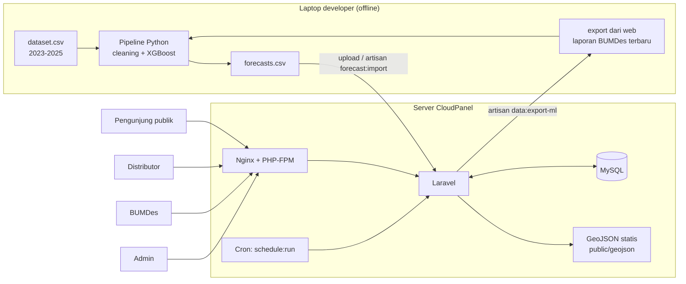

# Infrastruktur: Sistem Pemantauan & Early-Warning Surplus Pangan (Web)

| Item | Detail |
|---|---|
| **Dokumen** | infrastruktur.md (pendamping `prd.md` v1.1 dan `databaseschema.md`) |
| **Versi** | v1.0 – Draft |
| **Tanggal** | 11 Oktober 2026 |
| **Target** | MVP 18 Oktober 2026 (prototipe + video demo) |
| **Ruang lingkup** | Arsitektur, stack, struktur proyek, pipeline ML, deployment, keamanan, performa |

> **Legenda:** **[Keputusan]** = berasal dari PRD/tim · **[Rekomendasi]** = saran saya · **[Cek]** = perlu diverifikasi di lingkungan nyata sebelum dipakai.

---

## 1. Ringkasan Arsitektur

Sistem dibagi dua bagian yang **sengaja dipisah** agar sederhana dan cukup untuk 1 developer dalam 7 hari **[Rekomendasi]**:

1. **Aplikasi web (online):** Laravel + MySQL di server CloudPanel. Melayani peta, dashboard, pengiriman, dan modul BUMDes.
2. **Pipeline ML (offline):** Python + XGBoost dijalankan di laptop developer. Menghasilkan `forecasts.csv` yang kemudian diimpor ke web lewat Artisan command atau halaman admin.



**Prinsip desain**
- **Prediksi dihitung di muka**, bukan saat halaman dibuka. Web hanya membaca hasil dari database **[Keputusan: tidak real-time]**.
- **Tidak ada layanan eksternal wajib** saat runtime (tanpa API ekspedisi, tanpa notifikasi push/email/WA) **[Keputusan]**.
- **Peta tanpa basemap tile eksternal** (hanya poligon GeoJSON berwarna) agar tidak bergantung pada server peta pihak lain dan lebih ringan **[Rekomendasi]**.

## 2. Komponen & Teknologi

| Lapisan | Pilihan | Catatan |
|---|---|---|
| Web server | Nginx + PHP-FPM (dikelola CloudPanel) | **[Keputusan]** hosting CloudPanel |
| Bahasa & framework | PHP + **Laravel** | **[Keputusan]**. Pakai versi Laravel stabil terbaru yang cocok dengan versi PHP di server (umumnya PHP ≥ 8.2) **[Cek]** |
| Database | **MySQL** (atau MariaDB bila itu bawaan CloudPanel), engine InnoDB, charset `utf8mb4` | **[Keputusan]** MySQL **[Cek versi]** |
| Autentikasi | Session auth bawaan Laravel. Pilih satu: starter kit Blade bila tersedia, atau `Auth::attempt` manual | **[Rekomendasi]** |
| Otorisasi | Middleware `role:` + Policy untuk data milik sendiri | 3 role: `distributor`, `bumdes`, `admin` |
| Tampilan | Blade + Tailwind CSS | **[Rekomendasi]** cepat untuk MVP |
| Peta | **Leaflet** + GeoJSON provinsi & kabupaten | **[Rekomendasi]**; MapLibre sebagai alternatif |
| Grafik | **Chart.js** | **[Asumsi dari PRD]** |
| Build aset | Vite, **di-build di laptop**, hasil `public/build` ikut di-deploy | Server tidak perlu Node |
| ML | Python 3.10+: pandas, numpy, scikit-learn, xgboost | Dijalankan offline **[Rekomendasi]** |
| Penjadwalan | Laravel Scheduler dipanggil cron tiap menit | Untuk hitung ulang status & pembersihan |
| Cache | Driver `file` atau `database` | Tidak perlu Redis untuk MVP |
| Sesi/antrean | `session=database` atau `file`, `queue=sync` | Tanpa worker agar sederhana |

## 3. Lingkungan

| Lingkungan | Fungsi | Keterangan |
|---|---|---|
| **Local (laptop)** | Pengembangan, latih model, build aset | MySQL lokal (Laragon/XAMPP/Docker) |
| **Production (CloudPanel)** | Demo dan pengumpulan lomba | Satu situs PHP + satu database. **Staging tidak dibuat** (tidak cukup waktu) **[Rekomendasi]** |

Kontrol versi: **Git** (repo privat). `.env`, dataset mentah, dan model besar **tidak** di-commit.

## 4. Struktur Proyek **[Rekomendasi]**

```
nama-proyek/
├─ app/
│  ├─ Console/Commands/
│  │   ├─ ImportDataHistoris.php      # data:import-historis {file}
│  │   ├─ ImportForecast.php          # forecast:import {file}
│  │   ├─ ExportDataForMl.php         # data:export-ml
│  │   └─ RecalcStatusWilayah.php     # status:recalc {--periode=}
│  ├─ Http/
│  │   ├─ Controllers/ (Peta, Wilayah, Pengiriman, Panen, JadwalTanam, Admin/*)
│  │   ├─ Middleware/EnsureRole.php
│  │   └─ Requests/ (validasi form)
│  ├─ Models/ (User, Role, Provinsi, Kabupaten, Komoditas, DataHistoris,
│  │            Forecast, StatusWilayah, Shipment, ShipmentEvent,
│  │            HarvestReport, PlantingRecommendation, Setting, ModelVersion)
│  ├─ Policies/ (ShipmentPolicy, HarvestReportPolicy)
│  └─ Services/
│      ├─ StatusService.php           # rumus rasio & level status
│      ├─ ForecastImporter.php
│      └─ NumberFormatter.php         # tampilan kg/ton
├─ database/ (migrations, seeders)
├─ resources/views/ (layouts, peta, pengiriman, panen, admin)
├─ resources/js/ (peta.js, chart.js, app.js)
├─ public/geojson/ (provinsi.json, kabupaten.json)   # sudah disederhanakan
├─ storage/app/imports/                              # file CSV unggahan (tidak publik)
└─ ml/                                               # pipeline Python (offline)
   ├─ data/ (raw/, processed/)                       # tidak di-commit
   ├─ src/ (prepare.py, features.py, train.py, evaluate.py, forecast.py)
   ├─ models/                                        # file model (tidak di-commit)
   ├─ outputs/ (forecasts.csv, metrik.json)
   └─ requirements.txt
```

## 4b. Layanan Inti di Aplikasi

| Layanan | Tugas |
|---|---|
| **StatusService** | Menghitung `rasio = supply / demand` dan memetakan ke status `defisit/seimbang/waspada/penuh` memakai ambang dari tabel `settings` (default 0,70 / 0,90 / 1,00) |
| **ForecastImporter** | Memvalidasi dan memuat `forecasts.csv` (kode kabupaten valid, periode valid, kunci unik), mencatat hasil di `dataset_imports` |
| **Recalc status** | Mengisi tabel `status_wilayah` dari prediksi, data aktual, laporan BUMDes, dan pengiriman (lihat `databaseschema.md`) |
| **NumberFormatter** | Aturan tampilan: **≤ 2.000 kg → kg**, **> 2.000 kg → ton dengan 1 desimal**, format Indonesia (titik ribuan, koma desimal) **[Keputusan]** |

## 5. Alur Data & Siklus Bulanan

### 5.1 Setup awal (sekali)
1. Siapkan `dataset.csv` sesuai `dataset_template.csv`.
2. `php artisan db:seed` untuk master data (provinsi, kabupaten, komoditas, role, pengaturan).
3. `php artisan data:import-historis storage/app/imports/dataset.csv`.
4. Latih model offline, hasilkan `forecasts.csv` (lihat bagian 6).
5. `php artisan forecast:import storage/app/imports/forecasts.csv`.
6. `php artisan status:recalc` agar peta terisi.

### 5.2 Siklus bulanan **[Keputusan: prediksi diperbarui tiap bulan]**
```
BUMDes input panen + sisa stok (web)
        ↓
Admin unggah data bulan baru (demand, curah hujan, dll.) → data_historis
        ↓
php artisan data:export-ml  → ml/data/processed/latest.csv   (data_historis + laporan BUMDes)
        ↓
python ml/src/forecast.py   → ml/outputs/forecasts.csv       (12 bulan ke depan)
        ↓
Admin unggah forecasts.csv  → forecast:import → status:recalc
```

### 5.3 Retraining **[Keputusan: kuartalan]**
Setiap 3 bulan, atau bila error aktual vs prediksi melewati batas 2 bulan berturut-turut: jalankan `python ml/src/train.py`, simpan versi baru ke `model_versions`, lalu hasilkan forecast baru.

## 6. Pipeline ML (offline)

### 6.1 Persiapan
```bash
cd ml
python -m venv .venv
source .venv/bin/activate          # Windows: .venv\Scripts\activate
pip install -r requirements.txt
```

`requirements.txt` (versi disematkan setelah pertama kali berjalan):
```
pandas
numpy
scikit-learn
xgboost
pyarrow
```

### 6.2 Langkah skrip
| Skrip | Fungsi |
|---|---|
| `prepare.py` | Baca CSV, validasi skema, tangani sel kosong, hitung `stok_awal` cadangan, susun fitur lag/rolling |
| `features.py` | Fitur: bulan/musim, lag ≥ jarak horizon, rata-rata bergerak, curah hujan, penduduk, kabupaten & komoditas, jarak horizon (direct multi-horizon) |
| `train.py` | Latih XGBoost untuk **3 target**: panen, pasokan masuk, demand. Validasi waktu: latih 2023–2024, uji 2025. Latih ulang final pada seluruh data |
| `evaluate.py` | WAPE, MAE, RMSE per horizon (1, 3, 6, 12) dan baseline "bulan sama tahun lalu"; precision/recall/F1 status |
| `forecast.py` | Prediksi 12 bulan; **hitung supply bergulir** dari sisa stok terakhir; tentukan `status_pred`; tulis `forecasts.csv` sesuai format di `prd.md` bagian 9.2b |

### 6.3 Keterbatasan yang perlu diingat
- Histori hanya ±36 bulan, jadi **fitur lag 12 hanya terisi ±24 bulan terakhir**.
- Jangan pakai fitur yang baru diketahui di masa depan (data leakage). Lag harus ≥ jarak horizon.
- Python di server **tidak diperlukan**. **[Cek]** bila nanti ingin menjalankan di CloudPanel.

## 7. Endpoint Aplikasi

### 7.1 Publik (tanpa login) **[Keputusan]**
| Method | Path | Fungsi |
|---|---|---|
| GET | `/` | Peta Indonesia (heatmap), filter komoditas & bulan |
| GET | `/wilayah/{kode}` | Detail wilayah (grafik, status, pesan dampak) |
| GET | `/api/status` | Status wilayah. Query: `komoditas`, `periode`, `level=provinsi\|kabupaten` |
| GET | `/api/wilayah/{kode}/seri` | Data deret waktu aktual vs prediksi |
| GET | `/geojson/provinsi.json`, `/geojson/kabupaten.json` | File statis |

### 7.2 Terautentikasi
| Method | Path | Peran | Fungsi |
|---|---|---|---|
| GET/POST | `/login`, `/logout` | Semua | Masuk/keluar |
| GET | `/pengiriman` | Distributor, Admin | Daftar pengiriman (milik sendiri / semua) |
| GET/POST | `/pengiriman/buat`, `/pengiriman` | Distributor | Buat pengiriman (nomor resi diinput sendiri) |
| GET | `/api/wilayah/{kode}/cek` | Distributor | Cek status tujuan untuk banner info (non-blocking) |
| GET | `/pengiriman/{id}` | Pemilik, Admin | Detail & riwayat perjalanan |
| POST | `/pengiriman/{id}/event` | Pemilik, Admin | Tambah status/riwayat (manual) |
| GET/POST | `/panen` | BUMDes, Admin | Form panen & sisa stok (survei), rekap |
| GET | `/jadwal-tanam` | BUMDes, Admin | Rekomendasi (dummy) |
| GET/POST | `/admin/pengguna` | Admin | Kelola akun |
| POST | `/admin/dataset`, `/admin/forecast` | Admin | Unggah & impor CSV |
| POST | `/admin/status/recalc` | Admin | Hitung ulang status |
| GET/POST | `/admin/pengaturan` | Admin | Ambang status, teks disclaimer |

## 8. Peta & GeoJSON

| Hal | Rancangan |
|---|---|
| Sumber batas wilayah | File GeoJSON provinsi dan kabupaten/kota Indonesia (sumber resmi/komunitas; **[Cek]** lisensi). `properties` harus memuat **kode wilayah** yang sama dengan `kabupaten.kode` / `provinsi.kode` |
| Penyederhanaan | Sederhanakan geometri (mis. mapshaper: `mapshaper kabupaten.geojson -simplify 10% -o format=geojson kabupaten.json`) sampai ukuran ≈ 1–5 MB |
| Perpindahan level | Zoom rendah → layer provinsi; zoom tinggi → layer kabupaten. Ambang zoom ± 7–8 **[Asumsi]**; muat `kabupaten.json` secara *lazy* saat dibutuhkan |
| Pewarnaan | Gabungkan hasil `/api/status` ke GeoJSON **di sisi klien** berdasarkan kode. Warna: defisit, seimbang, waspada, penuh, abu-abu untuk tanpa data **[Keputusan]** |
| Status provinsi | Agregasi: total supply ÷ total demand seluruh kabupaten di provinsi itu **[Asumsi dari PRD]** |
| Fallback | Bila peta bermasalah, tampilkan tabel wilayah berwarna **[Keputusan]** |

## 9. Deployment di CloudPanel

> Nama menu CloudPanel bisa sedikit berbeda antarversi. **[Cek]** saat praktik.

### 9.1 Persiapan server
1. Buat **situs PHP** (pilih template Laravel bila tersedia). Pastikan **document root** menunjuk ke folder `public/`.
2. Pilih **versi PHP** sesuai syarat Laravel yang dipakai. Pastikan ekstensi umum aktif (mbstring, xml, curl, zip, pdo_mysql, bcmath, fileinfo).
3. Buat **database MySQL** dan user khusus (jangan pakai root).
4. Aktifkan **SSL** (Let's Encrypt) untuk domain/subdomain situs.

### 9.2 Pertama kali deploy
```bash
# di server (SSH sebagai user situs)
git clone <repo-privat> .            # atau unggah file lewat SFTP
composer install --no-dev --optimize-autoloader
cp .env.example .env                 # lalu isi sesuai bagian 10
php artisan key:generate
php artisan migrate --force
php artisan db:seed --force          # master data + akun dummy
php artisan storage:link
php artisan config:cache && php artisan route:cache && php artisan view:cache
```
Aset front-end (`public/build`) di-build di laptop (`npm run build`) lalu ikut ter-commit atau diunggah; server tidak butuh Node.

### 9.3 Cron (Laravel Scheduler)
Tambahkan cron job di CloudPanel, tiap menit, sebagai user situs:
```
* * * * * php /home/<user>/htdocs/<domain>/artisan schedule:run >> /dev/null 2>&1
```

### 9.4 Update versi berikutnya
```bash
git pull
composer install --no-dev --optimize-autoloader
php artisan migrate --force
php artisan config:cache && php artisan route:cache && php artisan view:cache
```
Bila ada perubahan aset: build ulang di laptop dan unggah `public/build`.

### 9.5 Izin berkas
`storage/` dan `bootstrap/cache/` harus dapat ditulis oleh user PHP-FPM situs. `.env` tidak boleh dapat diakses publik (document root harus `public/`).

## 10. Konfigurasi `.env` (contoh, tanpa rahasia)

```
APP_NAME="<Nama Produk>"
APP_ENV=production
APP_DEBUG=false
APP_URL=https://<domain>
APP_LOCALE=id
APP_FALLBACK_LOCALE=id
APP_TIMEZONE=Asia/Jakarta

DB_CONNECTION=mysql
DB_HOST=127.0.0.1
DB_PORT=3306
DB_DATABASE=<nama_db>
DB_USERNAME=<user_db>
DB_PASSWORD=<isi_sendiri>

SESSION_DRIVER=database
CACHE_STORE=database
QUEUE_CONNECTION=sync
LOG_CHANNEL=daily

# Aplikasi
UNIT_SWITCH_KG=2000          # batas kg -> ton
STATUS_DEFISIT_MAX=0.70
STATUS_WASPADA_MIN=0.90
STATUS_PENUH_MIN=1.00
```
Nilai ambang final disimpan di tabel `settings` (dapat diubah Admin); variabel di atas hanya nilai awal untuk seeder.

## 11. Keamanan

| Aspek | Tindakan |
|---|---|
| Transport | HTTPS wajib; paksa redirect HTTP→HTTPS |
| Kata sandi | Hash bawaan Laravel; akun demo **wajib diganti kata sandinya** sebelum dipublikasikan, jangan memakai kata sandi lemah di server publik |
| Sesi/CSRF/XSS | Gunakan proteksi bawaan Laravel (token CSRF, escaping Blade `{{ }}`) |
| Otorisasi | Middleware `role`; Policy: distributor hanya melihat/ubah pengiriman miliknya; BUMDes hanya kabupaten akunnya; admin semua **[Keputusan]** |
| Publik | Hanya peta, detail wilayah, dan data agregat prediksi. **Resi dan data pengiriman tidak publik** **[Keputusan]** |
| Privasi data | Data penjualan hanya ditampilkan agregat per kabupaten **[Keputusan]**; pengiriman & akun termasuk data sensitif |
| Unggah CSV | Hanya Admin; batasi ukuran & tipe; simpan di `storage/app/imports` (tidak publik); validasi baris sebelum dimuat |
| Pembatasan laju | Rate limit pada login dan endpoint API |
| Rahasia | `.env` tidak di-commit; `APP_DEBUG=false` di production |
| Log | Catat impor data dan perubahan penting (tabel `dataset_imports`, opsional `audit_logs`) |

## 12. Performa & Cache

| Hal | Rancangan |
|---|---|
| Tabel `status_wilayah` | Hasil perhitungan disimpan di muka sehingga peta cukup satu query sederhana **[Rekomendasi]** |
| Indeks DB | Lihat `databaseschema.md` (indeks komposit untuk komoditas, periode, status) |
| Cache respons | Cache `/api/status` per (komoditas, periode, level), dibuang saat `status:recalc` atau saat ada laporan/pengiriman baru |
| GeoJSON | Sederhanakan, aktifkan kompresi gzip di Nginx, muat kabupaten secara lazy |
| Perkiraan ukuran data | `data_historis` ±55 ribu baris; `forecasts` ±18 ribu baris per pengiriman bulanan (±220 ribu/tahun); `status_wilayah` ±75 ribu baris. Semuanya ringan untuk MySQL |

## 13. Backup & Pemulihan

| Item | Cara |
|---|---|
| Database | Backup harian otomatis di CloudPanel (bila tersedia) dan `mysqldump` manual sebelum deploy besar **[Cek]** |
| Kode | Git (repo privat) |
| Data ML | Simpan `dataset.csv`, `forecasts.csv`, dan `metrik.json` di penyimpanan terpisah (di luar server) |
| Sebelum demo/pengumpulan | Ekspor dump database terakhir dan simpan |

## 14. Monitoring & Log

- Log Laravel (`storage/logs`, rotasi harian) untuk galat aplikasi.
- Endpoint kesehatan bawaan Laravel (`/up`) untuk cek cepat situs hidup **[Cek ketersediaan sesuai versi]**.
- Halaman admin menampilkan **riwayat impor** dan **versi model aktif** beserta tanggal pembaruan prediksi.

## 15. Data Demo & Seeder

| Seeder | Isi |
|---|---|
| `RoleSeeder` | `distributor`, `bumdes`, `admin` |
| `KomoditasSeeder` | `beras`, `jagung`, `singkong` |
| `WilayahSeeder` | Provinsi & kabupaten/kota dari master kode wilayah (harus sama dengan GeoJSON) |
| `SettingSeeder` | Ambang status, teks disclaimer ("sistem ini bukan layanan penjualan, hanya pemantauan dan tracking"), pesan dampak |
| `DemoUserSeeder` | 1 admin, 2–3 distributor, 3–5 BUMDes (tiap BUMDes terikat 1 kabupaten). **Data dummy** **[Keputusan]** |
| `DemoShipmentSeeder` | Beberapa pengiriman dummy dengan riwayat perjalanan, termasuk satu ke wilayah berstatus Penuh agar banner terlihat di video demo |
| `PlantingRecommendationSeeder` | Data contoh jadwal tanam (dummy) **[Keputusan]** |

## 16. Daftar Cek Infrastruktur (Hari Pertama)

- [ ] Versi PHP dan MySQL di CloudPanel diketahui, dan cocok dengan versi Laravel.
- [ ] Situs PHP dan database sudah dibuat, SSL aktif, document root = `public/`.
- [ ] Repo Git privat dibuat, `.gitignore` memuat `.env`, `ml/data`, `ml/models`, `storage/app/imports`.
- [ ] Dataset 2023–2025 sudah diisi ke format template; persentase kelengkapan diketahui.
- [ ] GeoJSON provinsi & kabupaten sudah ada dan kode wilayah cocok dengan dataset.
- [ ] Lingkungan Python lokal berjalan (`pip install -r requirements.txt`).
- [ ] Skema database dimigrasi di lokal tanpa galat.

## 17. Risiko Infrastruktur & Cadangan

| Risiko | Cadangan |
|---|---|
| Versi PHP/MySQL di CloudPanel tidak cocok | Pilih versi Laravel yang kompatibel, atau turunkan fitur yang butuh versi lebih baru |
| Server tidak mendukung Python | Tidak masalah; model dilatih di laptop |
| GeoJSON kabupaten terlalu berat | Sederhanakan lebih agresif; atau tampilkan kabupaten hanya setelah zoom; atau fallback tabel |
| Kode wilayah dataset ≠ kode GeoJSON | Buat tabel pemetaan kode di awal; uji join sebelum membangun fitur lain |
| Impor CSV besar timeout | Impor per bagian (per tahun/provinsi) memakai `chunk` dan jalankan lewat CLI, bukan lewat browser |
| Server mati saat demo | Siapkan **video demo** dan dump database sebagai bukti cadangan; jalankan versi lokal bila perlu |
| Waktu habis | Pangkas fitur Should/Could dulu; pertahankan alur utama: peta → buat pengiriman → banner info → tracking |
