# UML & Flowchart: Sistem Pemantauan & Early-Warning Surplus Pangan (Web)

| Item | Detail |
|---|---|
| **Dokumen** | uml.md (pendamping `prd.md` v1.1, `infrastruktur.md`, `databaseschema.md`) |
| **Versi** | v1.0 – Draft |
| **Tanggal** | 11 Oktober 2026 |
| **Notasi** | **Mermaid** (tampil sebagai gambar di GitHub, VS Code dengan ekstensi Mermaid, Obsidian, dan Claude) |

> **Catatan notasi.** Mermaid mendukung langsung diagram kelas, urutan (sequence), dan state machine. Diagram lain (use case, komponen, deployment, paket, struktur komposit, komunikasi, timing, interaction overview) **tidak punya tipe bawaan** di Mermaid, sehingga digambar dengan `flowchart`/`gantt` yang **meniru notasi UML** sedekat mungkin. Semantik tetap UML, bentuk visual sedikit berbeda. Bila perlu notasi UML baku (mis. untuk laporan), diagram dapat dipindahkan ke draw.io atau PlantUML.
>
> **Konsistensi.** Semua diagram mengikuti PRD dan skema database. Data pada diagram objek adalah **contoh fiktif**.

## Daftar Diagram

| # | Diagram | Bagian |
|---|---|---|
| 1 | Use Case Diagram | 1 |
| 2 | Class Diagram (model domain dan lapisan aplikasi) | 2 |
| 3 | Object Diagram | 3 |
| 4 | Component Diagram | 4 |
| 5 | Deployment Diagram | 5 |
| 6 | Package Diagram | 6 |
| 7 | Composite Structure Diagram | 7 |
| 8 | Activity Diagram | 8 |
| 9 | Sequence Diagram | 9 |
| 10 | State Machine Diagram | 10 |
| 11 | Communication Diagram | 11 |
| 12 | Timing Diagram | 12 |
| 13 | Interaction Overview Diagram | 13 |
| 14 | Flowchart | 14 |

---

## 1. Use Case Diagram

**Aktor:** Pengunjung publik (tanpa login), Distributor, BUMDes, Admin, dan Pipeline ML (offline, dijalankan developer).

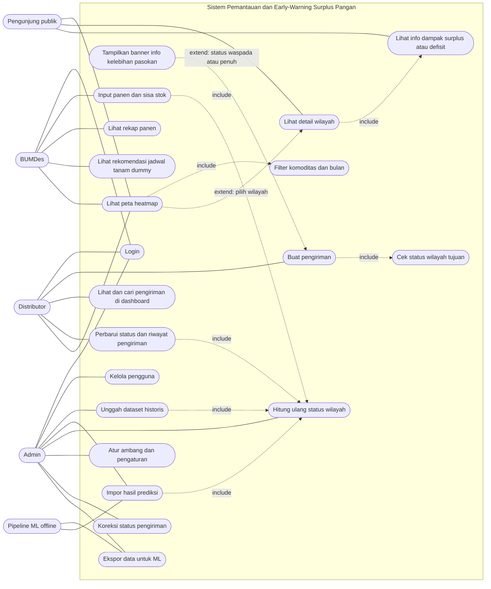

**Deskripsi singkat use case utama**

| Use case | Aktor | Prasyarat | Hasil |
|---|---|---|---|
| Lihat peta heatmap | Semua | Prediksi sudah diimpor | Peta berwarna menurut status; provinsi/kabupaten sesuai zoom |
| Buat pengiriman | Distributor | Login; nomor resi unik | Pengiriman tersimpan; banner info tampil bila tujuan Waspada/Penuh; **tidak diblokir** |
| Input panen dan sisa stok | BUMDes | Login; akun terikat ke satu kabupaten | Laporan bulanan tersimpan; sisa stok menjadi stok awal bulan berikutnya |
| Impor hasil prediksi | Admin | File `forecasts.csv` valid | Prediksi 12 bulan masuk database; status dihitung ulang |
| Atur ambang dan pengaturan | Admin | Login | Ambang status (default 0,70 / 0,90 / 1,00) dan teks pesan diperbarui |

---

## 2. Class Diagram

### 2.1 Model domain

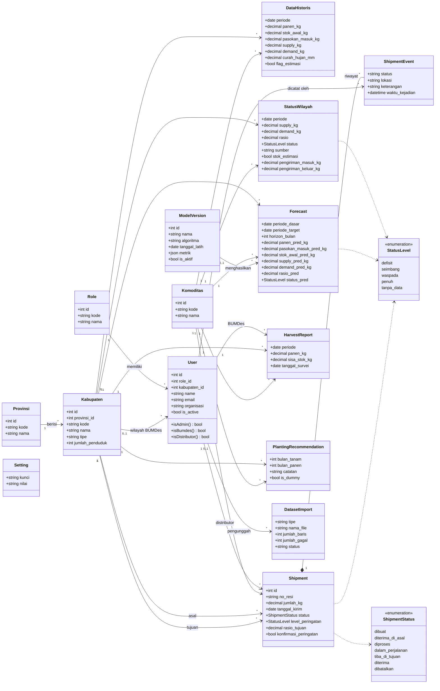

### 2.2 Lapisan aplikasi (controller, layanan, kebijakan, perintah)

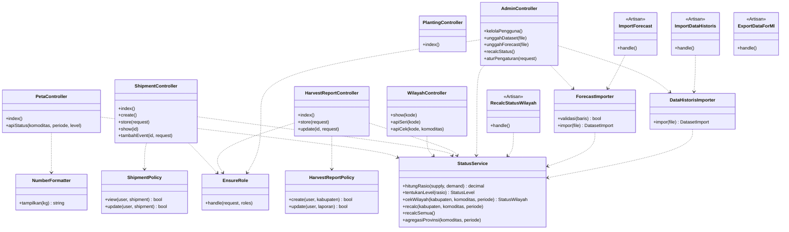

---

## 3. Object Diagram

Potret satu momen sistem (data **fiktif**): seorang distributor mengirim beras dari Cilacap ke Banyumas, yang pada Februari 2026 berstatus **Penuh**. BUMDes Banyumas sudah melapor panen bulan Januari.

```mermaid
classDiagram
    direction LR

    class roleDist["roleDist : Role"] {
        +kode = distributor
    }
    class roleBum["roleBum : Role"] {
        +kode = bumdes
    }
    class u1["u1 : User"] {
        +name = Budi Santoso contoh
        +organisasi = PT Contoh Pangan
    }
    class u2["u2 : User"] {
        +name = Pengurus BUMDes Banyumas contoh
        +organisasi = BUMDes Contoh
    }
    class kabAsal["kabAsal : Kabupaten"] {
        +kode = 3301
        +nama = Cilacap
    }
    class kabTuj["kabTuj : Kabupaten"] {
        +kode = 3302
        +nama = Banyumas
    }
    class kom1["kom1 : Komoditas"] {
        +kode = beras
    }
    class st1["st1 : StatusWilayah"] {
        +periode = 2026-02-01
        +supply_kg = 18500000
        +demand_kg = 17600000
        +rasio = 1.0511
        +status = penuh
        +stok_estimasi = false
    }
    class sh1["sh1 : Shipment"] {
        +no_resi = RESI-CONTOH-0001
        +jumlah_kg = 2500
        +status = dalam_perjalanan
        +level_peringatan = penuh
        +konfirmasi_peringatan = true
    }
    class ev1["ev1 : ShipmentEvent"] {
        +status = diproses
        +lokasi = Gudang Cilacap
    }
    class ev2["ev2 : ShipmentEvent"] {
        +status = dalam_perjalanan
        +lokasi = Perjalanan ke Banyumas
    }
    class hr1["hr1 : HarvestReport"] {
        +periode = 2026-01-01
        +panen_kg = 15200000
        +sisa_stok_kg = 3100000
    }

    roleDist --> u1
    roleBum --> u2
    u2 --> kabTuj : wilayah
    u1 --> sh1 : distributor
    kom1 --> sh1
    kabAsal --> sh1 : asal
    kabTuj --> sh1 : tujuan
    sh1 *-- ev1
    sh1 *-- ev2
    kabTuj --> st1
    kom1 --> st1
    u2 --> hr1 : pelapor
    kabTuj --> hr1
    kom1 --> hr1
    hr1 ..> st1 : sisa stok jadi stok awal Februari
```

Catatan: jumlah 2.500 kg ditampilkan di aplikasi sebagai **2,5 ton** (aturan tampilan: > 2.000 kg → ton, 1 desimal).

---

## 4. Component Diagram

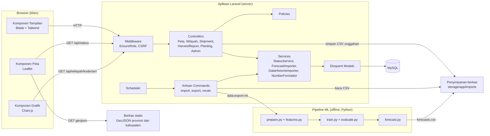

| Komponen | Antarmuka yang disediakan | Antarmuka yang dibutuhkan |
|---|---|---|
| StatusService | `hitungRasio`, `tentukanLevel`, `recalc` | Eloquent Models, Setting (ambang) |
| ForecastImporter | `impor(file)` | StatusService, DatasetImport |
| Pipeline ML | `forecasts.csv` | `latest.csv` hasil ekspor |
| GeoJSON statis | `/geojson/provinsi.json`, `/geojson/kabupaten.json` | — |

---

## 5. Deployment Diagram

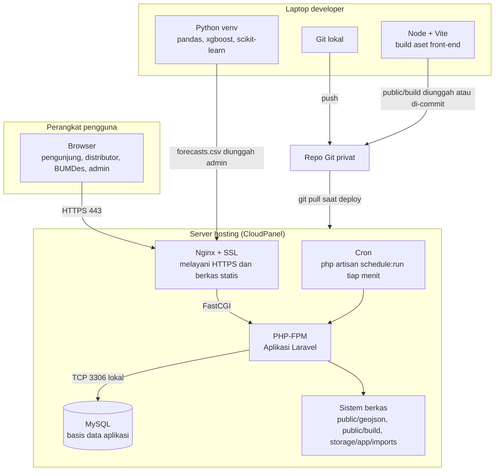

| Node | Perangkat lunak / artefak | Catatan |
|---|---|---|
| Server CloudPanel | Nginx, PHP-FPM, Laravel, MySQL, cron | Satu situs PHP + satu database; document root `public/` |
| Laptop developer | Python (ML), Node (build), Git | Model dilatih offline; server tidak perlu Python |
| Repo Git privat | Kode sumber | `.env`, dataset, dan model tidak di-commit |

---

## 6. Package Diagram

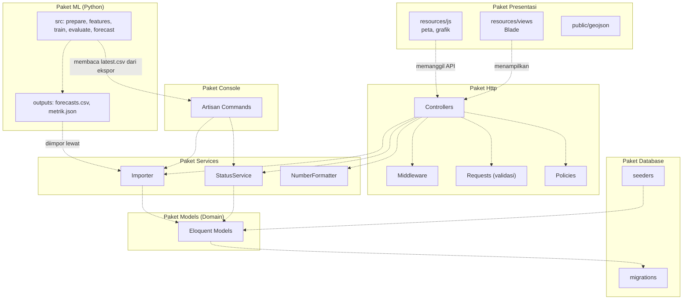

---

## 7. Composite Structure Diagram

Struktur internal kelas **StatusService**: bagian-bagian (parts), port, dan konektor yang bekerja sama menghitung status satu wilayah, komoditas, dan bulan.

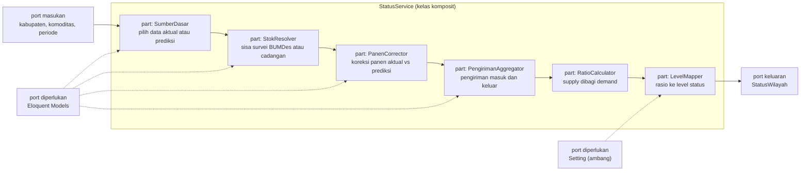

| Part | Tanggung jawab | Sumber data |
|---|---|---|
| SumberDasar | Memilih `data_historis` (aktual) atau `forecasts` terbaru (prediksi) menurut periode | data_historis, forecasts |
| StokResolver | Stok awal = sisa survei bulan sebelumnya; bila belum ada, hitungan cadangan `max(0, supply − demand)` dan tandai `stok_estimasi` | harvest_reports |
| PanenCorrector | `supply += panen_aktual − panen_prediksi` bila BUMDes sudah melapor | harvest_reports, forecasts |
| PengirimanAggregator | `supply += masuk − keluar` dari pengiriman non-batal pada bulan itu | shipments |
| RatioCalculator | `rasio = supply / demand`; `NULL` bila demand kosong atau 0 | — |
| LevelMapper | Memetakan rasio ke `defisit / seimbang / waspada / penuh / tanpa_data` | settings |

---

## 8. Activity Diagram

### 8.1 Distributor membuat pengiriman

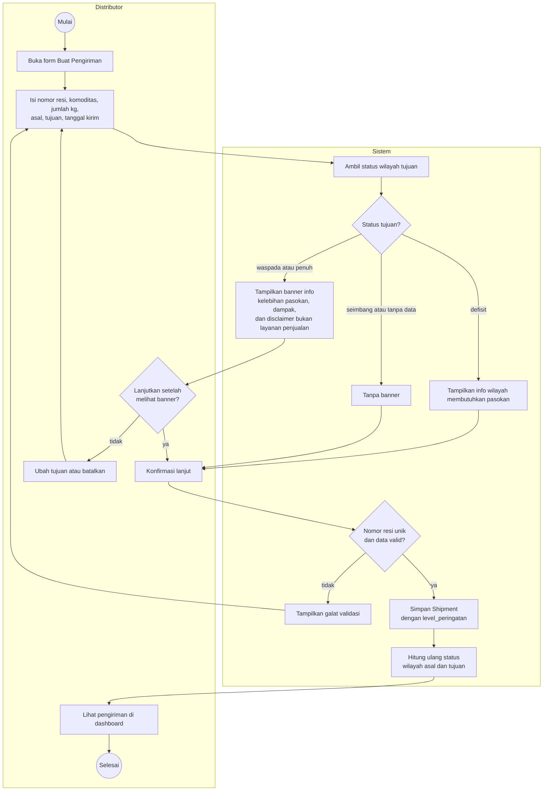

### 8.2 Siklus bulanan: laporan, data baru, prediksi

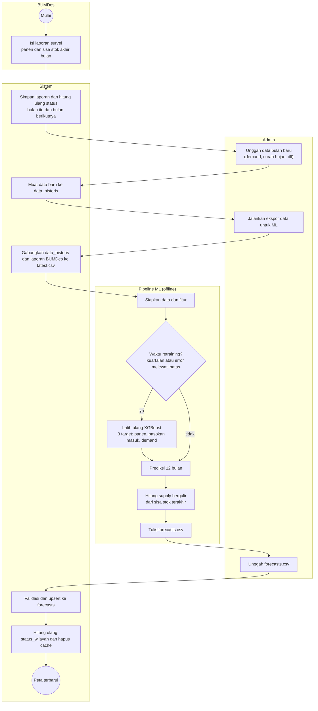

### 8.3 BUMDes menginput panen dan sisa stok

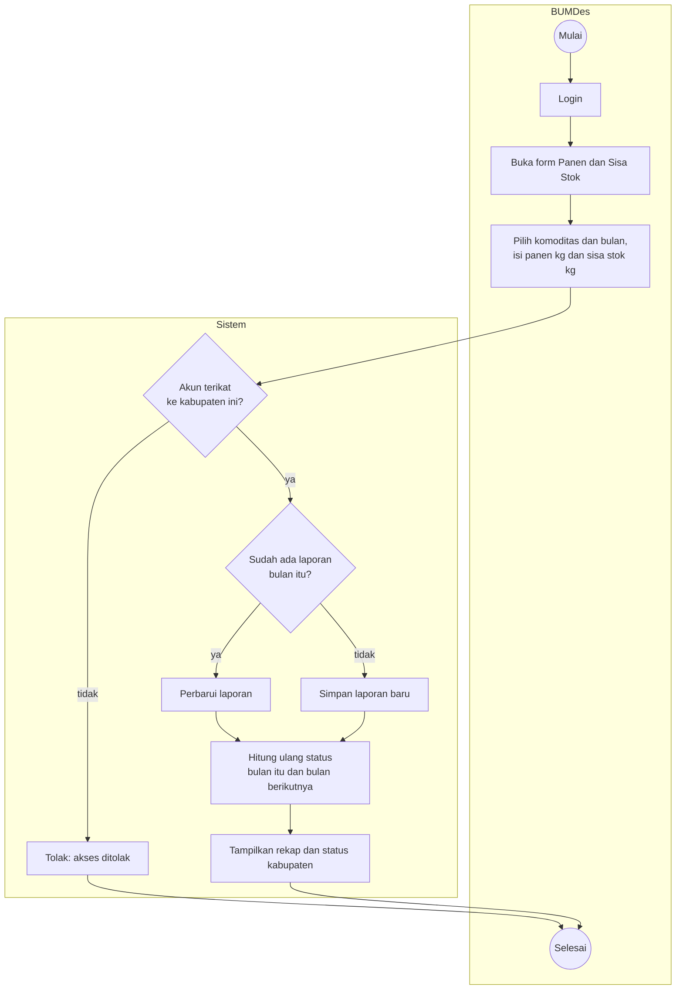

---

## 9. Sequence Diagram

### 9.1 Melihat peta (publik, tanpa login)

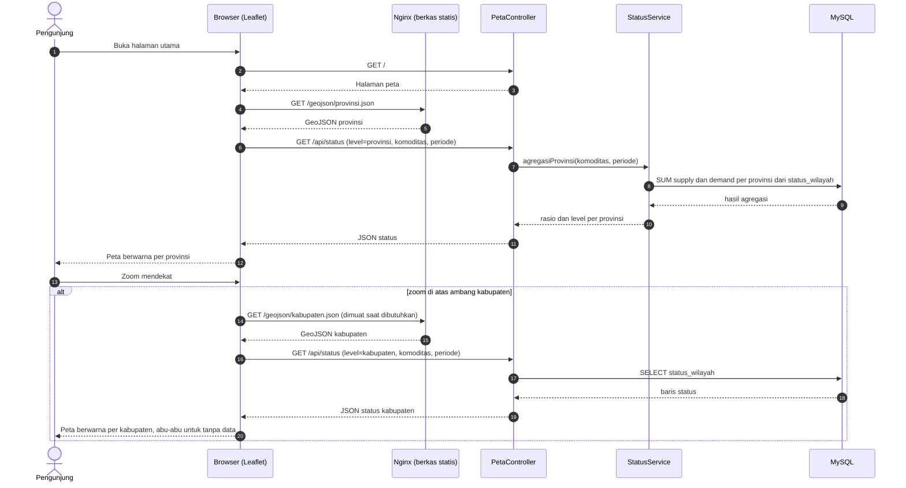

### 9.2 Login

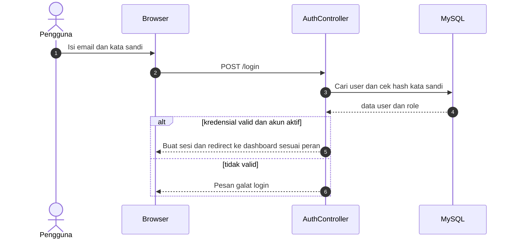

### 9.3 Membuat pengiriman dengan banner info

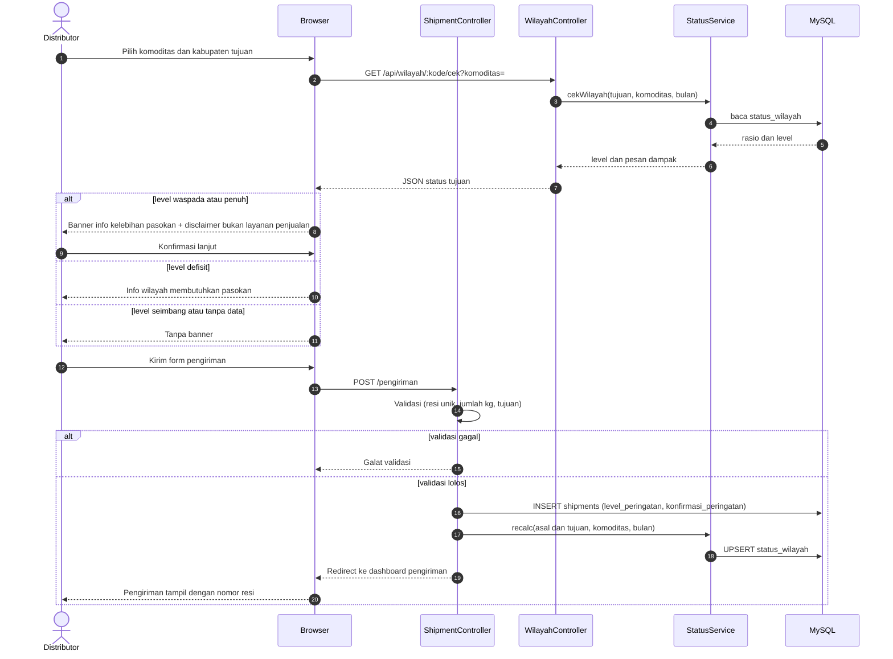

### 9.4 Memperbarui status pengiriman (manual oleh distributor)

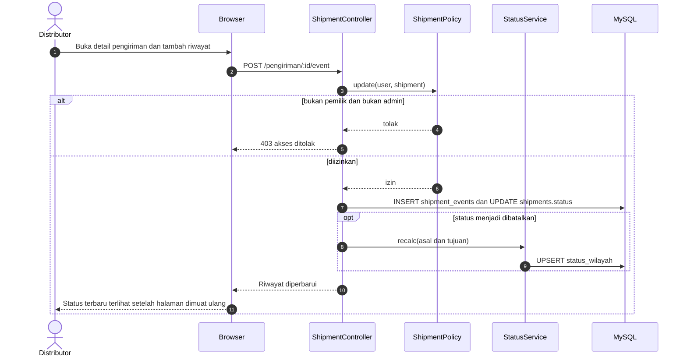

### 9.5 BUMDes menginput panen dan sisa stok

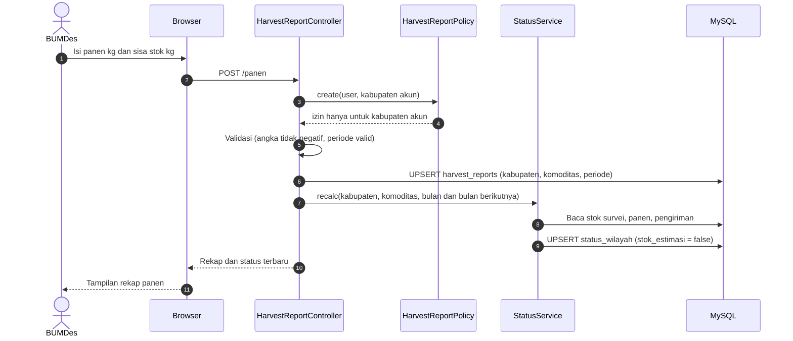

### 9.6 Admin mengimpor prediksi bulanan

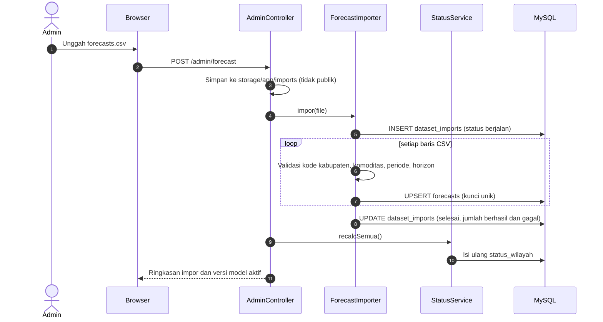

---

## 10. State Machine Diagram

### 10.1 Status Pengiriman (`shipments.status`)

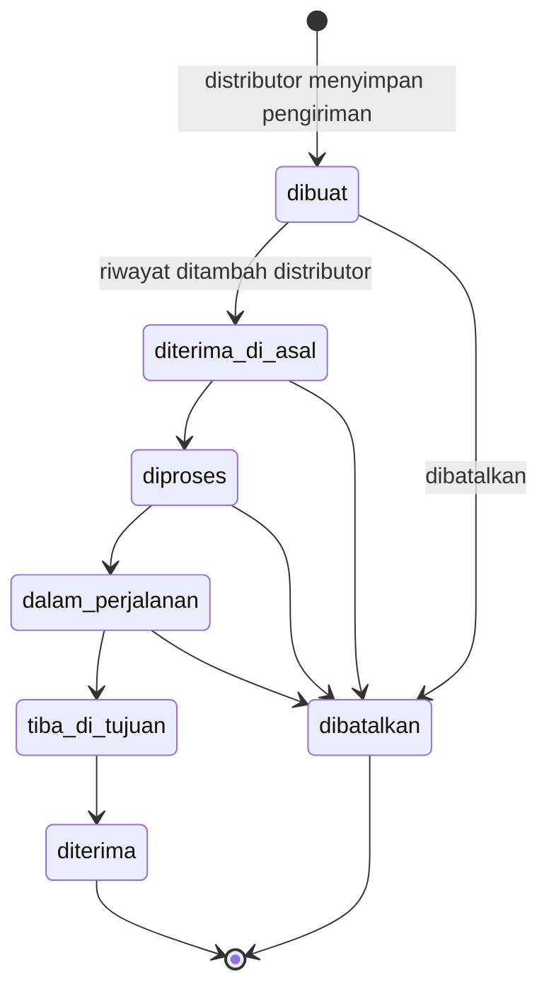

Catatan: daftar status adalah **contoh gaya JNE** dan masih perlu dikonfirmasi. Perubahan status dilakukan **manual** oleh distributor; admin dapat mengoreksi.

### 10.2 Level Status Wilayah (`status_wilayah.status`)

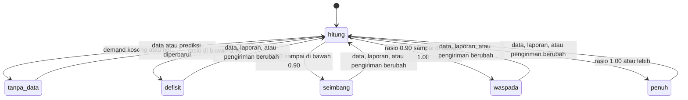

Ambang 0,70 / 0,90 / 1,00 adalah nilai awal dan dapat diubah Admin lewat tabel `settings`.

### 10.3 Impor Data (`dataset_imports.status`)

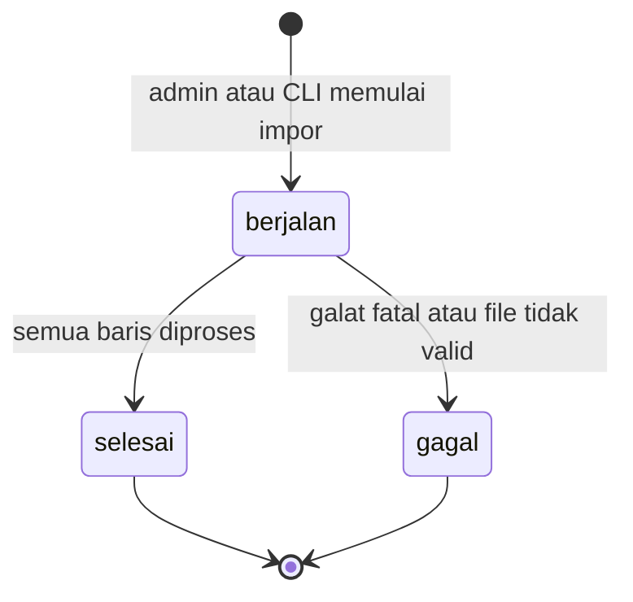

---

## 11. Communication Diagram

Skenario: **distributor menyimpan pengiriman**. Angka menunjukkan urutan pesan; angka bertingkat (2.1) menunjukkan pesan bersarang.

```mermaid
flowchart LR
    D(["aktor: Distributor"])
    SC["objek: ShipmentController"]
    PO["objek: ShipmentPolicy"]
    SS["objek: StatusService"]
    SW["objek: StatusWilayah"]
    SH["objek: Shipment"]

    D -->|"1: kirim form pengiriman"| SC
    SC -->|"2: otorisasi create"| PO
    SC -->|"3: cekWilayah(tujuan, komoditas, bulan)"| SS
    SS -->|"3.1: baca status"| SW
    SC -->|"4: simpan dengan level_peringatan"| SH
    SC -->|"5: recalc(asal dan tujuan)"| SS
    SS -->|"5.1: tulis ulang status"| SW
    SC -->|"6: redirect ke dashboard"| D
```

Skenario kedua: **BUMDes menyimpan laporan panen**.

```mermaid
flowchart LR
    U(["aktor: BUMDes"])
    HC["objek: HarvestReportController"]
    HP["objek: HarvestReportPolicy"]
    HR["objek: HarvestReport"]
    SS["objek: StatusService"]
    SW["objek: StatusWilayah"]

    U -->|"1: kirim form panen dan sisa stok"| HC
    HC -->|"2: otorisasi kabupaten akun"| HP
    HC -->|"3: upsert laporan"| HR
    HC -->|"4: recalc(bulan dan bulan berikutnya)"| SS
    SS -->|"4.1: baca laporan"| HR
    SS -->|"4.2: tulis status"| SW
    HC -->|"5: tampilkan rekap"| U
```

---

## 12. Timing Diagram

Mermaid tidak punya tipe timing diagram UML, sehingga **garis hidup (lifeline) digambar dengan Gantt**: setiap baris adalah satu objek, dan setiap batang adalah **state** objek itu pada rentang waktu tertentu. Tanggal hanya contoh.

### 12.1 Siklus bulanan (contoh bulan Februari 2026)

```mermaid
gantt
    title Timing siklus bulanan (contoh)
    dateFormat YYYY-MM-DD
    axisFormat %d
    section BUMDes
    Menyusun laporan survei         :b1, 2026-02-01, 4d
    Input panen dan sisa stok       :b2, after b1, 3d
    Menunggu bulan berikutnya       :b3, after b2, 21d
    section Admin
    Menyiapkan data bulan baru      :a1, 2026-02-05, 2d
    Ekspor data untuk ML            :a2, after a1, 1d
    Menunggu hasil prediksi         :a3, after a2, 2d
    Impor forecasts                 :a4, after a3, 1d
    Idle                            :a5, after a4, 18d
    section Pipeline ML
    Menyiapkan fitur                :m1, 2026-02-08, 1d
    Latih ulang bila waktunya       :m2, after m1, 1d
    Prediksi dan hitung supply      :m3, after m2, 1d
    section status_wilayah
    Memakai prediksi lama           :s1, 2026-02-01, 11d
    Hitung ulang                    :s2, after s1, 1d
    Memakai prediksi baru           :s3, after s2, 17d
    section Peta publik
    Menampilkan status lama         :p1, 2026-02-01, 11d
    Menampilkan status baru         :p2, after p1, 18d
```

### 12.2 Siklus hidup satu pengiriman (contoh)

```mermaid
gantt
    title Timing status satu pengiriman (contoh)
    dateFormat YYYY-MM-DD HH:mm
    axisFormat %d %H:%M
    section Status shipments
    dibuat              :c1, 2026-02-03 08:00, 3h
    diterima_di_asal    :c2, after c1, 5h
    diproses            :c3, after c2, 6h
    dalam_perjalanan    :c4, after c3, 20h
    tiba_di_tujuan      :c5, after c4, 4h
    diterima            :c6, after c5, 2h
    section Perhitungan supply tujuan
    Pengiriman dihitung sebagai masuk :d1, 2026-02-03 08:00, 40h
    section Aktor
    Distributor menambah riwayat      :milestone, e1, 2026-02-03 11:00, 0h
    Distributor menambah riwayat lagi :milestone, e2, 2026-02-03 16:00, 0h
    Distributor menambah riwayat akhir :milestone, e3, 2026-02-04 18:00, 0h
```

Catatan: kendala waktu (timing constraint) yang relevan: prediksi diperbarui **sekali per bulan**, laporan BUMDes **sekali per bulan per komoditas**, dan status pengiriman **terbarui saat halaman dimuat ulang** (tidak real-time/push).

---

## 13. Interaction Overview Diagram

Diagram alur tingkat tinggi yang menghubungkan beberapa interaksi. Kotak berawalan **ref** merujuk ke sequence diagram pada bagian 9.

```mermaid
flowchart TD
    S0(("Mulai"))
    R1["ref: sd Melihat peta (9.1)"]
    Q1{"Perlu fitur<br/>berbasis peran?"}
    R2["ref: sd Login (9.2)"]
    Q2{"Peran pengguna?"}

    R3["ref: sd Membuat pengiriman (9.3)"]
    R4["ref: sd Memperbarui status pengiriman (9.4)"]
    Q3{"Pengiriman<br/>sudah selesai?"}

    R5["ref: sd BUMDes input panen dan sisa stok (9.5)"]

    R6["ref: sd Admin impor prediksi (9.6)"]

    S9(("Selesai"))

    S0 --> R1 --> Q1
    Q1 -->|"tidak"| S9
    Q1 -->|"ya"| R2 --> Q2

    Q2 -->|"distributor"| R3 --> R4 --> Q3
    Q3 -->|"belum"| R4
    Q3 -->|"sudah"| S9

    Q2 -->|"BUMDes"| R5 --> S9

    Q2 -->|"admin"| R6 --> S9
```

---

## 14. Flowchart

### 14.1 Alur sistem secara keseluruhan

```mermaid
flowchart TD
    A(["Mulai"]) --> B["Siapkan dataset riil 2023-2025<br/>format dataset_template.csv"]
    B --> C["Validasi dan bersihkan data<br/>kode wilayah cocok dengan GeoJSON"]
    C --> D["Latih XGBoost offline<br/>panen, pasokan masuk, demand"]
    D --> E["Hitung supply bergulir<br/>dan prediksi 12 bulan"]
    E --> F["Hasilkan forecasts.csv"]
    F --> G["Admin impor ke web"]
    G --> H["Hitung status_wilayah"]
    H --> I["Peta heatmap tampil untuk semua orang"]

    I --> J{"Pengguna login<br/>dan memiliki peran?"}
    J -->|"distributor"| K["Buat pengiriman dan lacak resi"]
    J -->|"BUMDes"| L["Input panen dan sisa stok bulanan"]
    J -->|"admin"| M["Kelola data, pengguna, ambang"]
    J -->|"tidak login"| N["Lihat peta, detail, dan info dampak"]

    K --> H
    L --> H
    M --> G

    H --> O{"Sudah akhir bulan?"}
    O -->|"ya"| P["Ekspor data terbaru ke ML<br/>dan ulangi prediksi"]
    P --> D
    O -->|"tidak"| I
```

### 14.2 Algoritma penentuan status wilayah

```mermaid
flowchart TD
    A(["Mulai: kabupaten, komoditas, periode"]) --> B{"Periode sudah punya<br/>data aktual?"}
    B -->|"ya"| C["Ambil data_historis<br/>sumber = aktual"]
    B -->|"tidak"| D["Ambil forecast terbaru<br/>sumber = prediksi"]
    C --> E{"Ada laporan BUMDes<br/>bulan sebelumnya?"}
    D --> E
    E -->|"ya"| F["stok_awal = sisa_stok dari survei<br/>stok_estimasi = tidak"]
    E -->|"tidak"| G["stok_awal = max(0, supply - demand) bulan lalu<br/>stok_estimasi = ya"]
    F --> H["supply = panen + stok_awal + pasokan_masuk"]
    G --> H
    H --> I{"Ada laporan panen<br/>bulan ini?"}
    I -->|"ya"| J["supply = supply + panen_aktual - panen_prediksi"]
    I -->|"tidak"| K["Lewati koreksi panen"]
    J --> L["supply = supply + pengiriman_masuk - pengiriman_keluar"]
    K --> L
    L --> M{"demand kosong<br/>atau nol?"}
    M -->|"ya"| N["status = tanpa_data<br/>(abu-abu)"]
    M -->|"tidak"| O["rasio = supply / demand"]
    O --> P{"rasio?"}
    P -->|"kurang dari 0.70"| Q["status = defisit"]
    P -->|"0.70 sampai kurang dari 0.90"| R["status = seimbang"]
    P -->|"0.90 sampai kurang dari 1.00"| S["status = waspada"]
    P -->|"1.00 atau lebih"| T["status = penuh"]
    N --> U["Simpan ke status_wilayah"]
    Q --> U
    R --> U
    S --> U
    T --> U
    U --> V(["Selesai"])
```

### 14.3 Pipeline machine learning (offline)

```mermaid
flowchart TD
    A(["Mulai"]) --> B["Baca latest.csv<br/>data historis + laporan BUMDes"]
    B --> C["Validasi skema dan kode wilayah"]
    C --> D{"Ada sel kosong<br/>pada stok_awal?"}
    D -->|"ya"| E["Isi cadangan: max(0, supply - demand) bulan lalu"]
    D -->|"tidak"| F["Lanjut"]
    E --> G["Susun fitur: musim, lag minimal sepanjang horizon,<br/>rata-rata bergerak, curah hujan, kabupaten, komoditas, horizon"]
    F --> G
    G --> H{"Waktunya retraining?<br/>kuartalan atau error melewati batas"}
    H -->|"ya"| I["Latih XGBoost 3 target<br/>validasi waktu: latih 2023-2024, uji 2025"]
    I --> J["Evaluasi: WAPE, MAE, RMSE per horizon,<br/>bandingkan dengan baseline tahun lalu"]
    J --> K{"Lebih baik dari<br/>baseline?"}
    K -->|"tidak"| L["Tinjau fitur dan parameter"]
    L --> I
    K -->|"ya"| M["Simpan model dan metrik<br/>ke model_versions"]
    H -->|"tidak"| N["Pakai model aktif"]
    M --> O["Prediksi panen, pasokan masuk, demand<br/>untuk 12 bulan"]
    N --> O
    O --> P["Hitung supply bergulir<br/>dari sisa stok terakhir"]
    P --> Q["Hitung rasio dan status per bulan"]
    Q --> R["Tulis forecasts.csv"]
    R --> S(["Selesai"])
```

---

## 15. Catatan Konsistensi & Hal yang Perlu Dikonfirmasi

| Hal | Status |
|---|---|
| Daftar status pengiriman (diagram 10.1) | Contoh gaya JNE; perlu dikonfirmasi tim |
| Aturan pembatalan pengiriman (dari status mana boleh) | Diasumsikan boleh sebelum `diterima`; perlu dikonfirmasi |
| Ambang zoom pergantian provinsi → kabupaten | ± 7–8; disesuaikan saat uji peta |
| Definisi "pengiriman aktif" pada perhitungan supply | Saat ini semua pengiriman non-batal pada bulan itu |
| Penanda notasi | Diagram use case, komponen, deployment, paket, struktur komposit, komunikasi, timing, dan interaction overview digambar dengan Mermaid `flowchart`/`gantt` yang meniru notasi UML |
